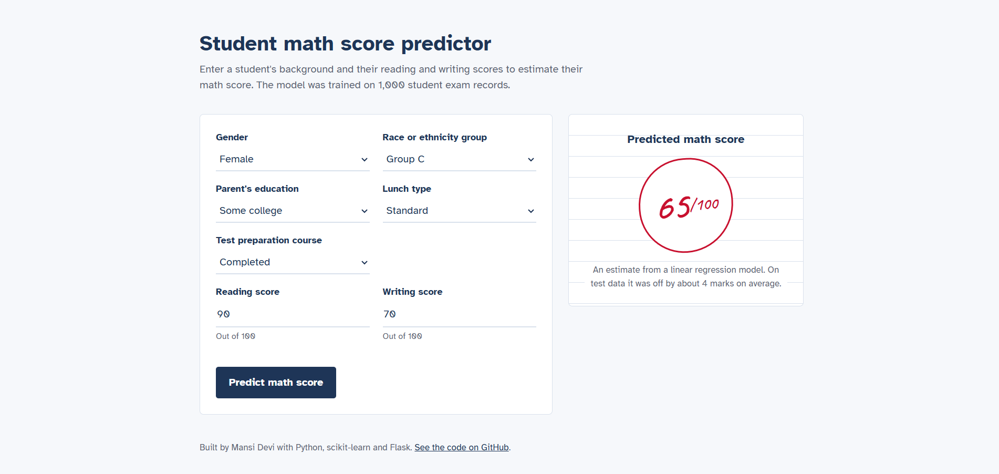
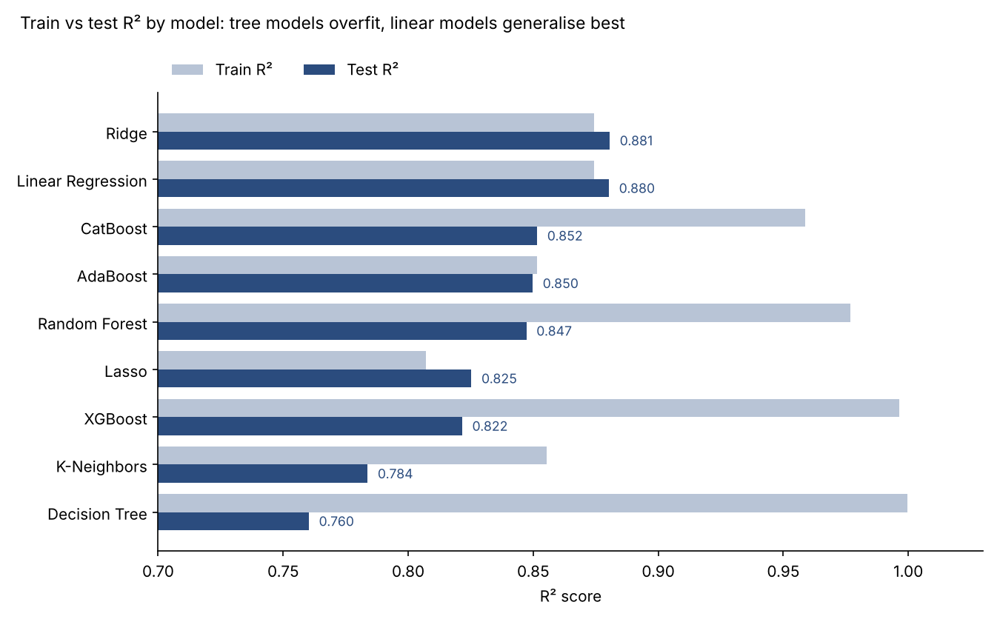

# Student Performance Predictor

An end-to-end machine learning project that predicts a student's **math score** from their background and their reading and writing scores. It covers the full workflow: exploratory data analysis, a reusable preprocessing pipeline, comparison of 9 regression models with hyperparameter tuning, and a Flask web app that serves live predictions.

**Live demo:** _add your deployed link here_



## Results at a glance

- **Best model:** Linear Regression / Ridge, with a **test R² of 0.88** and a mean absolute error of about **4.2 marks** (out of 100).
- **Key finding:** the tree-based models (Decision Tree, XGBoost, Random Forest) scored almost perfectly on the training data (R² 0.97–1.00) but dropped to 0.76–0.85 on unseen test data. They memorised the training set. The simpler linear models generalised best, because the relationship between reading/writing scores and math scores is mostly linear.



| Model | Train R² | Test R² | Test MAE | Test RMSE |
|---|---|---|---|---|
| Ridge | 0.874 | **0.881** | 4.21 | 5.39 |
| Linear Regression | 0.874 | **0.880** | 4.22 | 5.40 |
| CatBoost | 0.959 | 0.852 | 4.61 | 6.01 |
| AdaBoost | 0.852 | 0.850 | 4.68 | 6.04 |
| Random Forest | 0.977 | 0.847 | 4.72 | 6.10 |
| Lasso | 0.807 | 0.825 | 5.16 | 6.52 |
| XGBoost | 0.996 | 0.822 | 5.08 | 6.59 |
| K-Neighbors | 0.856 | 0.784 | 5.62 | 7.25 |
| Decision Tree | 1.000 | 0.760 | 6.03 | 7.64 |

_Scores from `notebook/2. MODEL TRAINING.ipynb` on an 80/20 train/test split (800 / 200 students)._

## The problem

Can we estimate how a student will perform in math using information that is already available, such as their scores in other subjects and their background? A model like this could help teachers spot students who may need extra support in math early.

## Dataset

[Students Performance in Exams](https://www.kaggle.com/datasets/spscientist/students-performance-in-exams) (Kaggle): 1,000 students, 8 columns, no missing values.

| Column | Type | Description |
|---|---|---|
| `gender` | categorical | female / male |
| `race_ethnicity` | categorical | anonymised groups A–E |
| `parental_level_of_education` | categorical | from "some high school" to "master's degree" |
| `lunch` | categorical | standard / free or reduced |
| `test_preparation_course` | categorical | none / completed |
| `reading_score` | numeric | 0–100 |
| `writing_score` | numeric | 0–100 |
| `math_score` | numeric | 0–100 (**target**) |

## What the EDA showed

- Math scores are strongly correlated with reading (0.82) and writing (0.80) scores, which is why a linear model works well.
- Students with a standard lunch averaged about **70** in math, compared with about **59** for students on free or reduced lunch. Lunch type acts as a proxy for socio-economic background.
- Students who completed the test preparation course averaged about **70**, compared with about **64** for those who did not.

See `notebook/1 . EDA STUDENT PERFORMANCE .ipynb` for the full analysis and charts.

## Approach

1. **Data ingestion** (`src/components/data_ingestion.py`): reads the raw CSV and creates an 80/20 train/test split.
2. **Preprocessing** (`src/components/data_transformation.py`): a scikit-learn `ColumnTransformer` that imputes missing values, one-hot encodes the categorical columns and scales the numeric columns. It is saved as `artifacts/preprocessor.pkl` so the web app applies exactly the same steps.
3. **Model training** (`src/components/model_trainer.py`): trains 7 regression models, tunes each with `GridSearchCV` (3-fold cross-validation), and saves the best one by test R² as `artifacts/model.pkl`.
4. **Prediction app** (`app.py`): a Flask app that takes form input, runs it through the saved preprocessor and model, and shows the predicted score.

The code is modular, with custom exception handling (`src/exception.py`) and logging (`src/logger.py`).

## Project structure

```
├── app.py                      # Flask web app
├── artifacts/                  # saved model, preprocessor and data splits
├── images/                     # README images
├── notebook/
│   ├── 1 . EDA STUDENT PERFORMANCE .ipynb
│   ├── 2. MODEL TRAINING.ipynb
│   └── data/stud.csv
├── src/
│   ├── components/             # ingestion, transformation, training
│   ├── pipeline/               # train_pipeline.py, predict_pipeline.py
│   ├── exception.py
│   ├── logger.py
│   └── utils.py
├── templates/home.html
├── requirements.txt
└── setup.py
```

## How to run it locally

```bash
git clone https://github.com/mansidevi8128-glitch/student-performance-predictor.git
cd student-performance-predictor
python -m venv venv
venv\Scripts\activate          # on Windows; use "source venv/bin/activate" on macOS/Linux
pip install -r requirements.txt

# Optional: retrain the model (overwrites the files in artifacts/)
python -m src.pipeline.train_pipeline

# Start the web app, then open http://127.0.0.1:5000
python app.py
```

## Limitations and next steps

- **Reading and writing scores do most of the work.** Without them, predicting math scores from background alone would be much harder. A useful next experiment is to measure how much accuracy drops when they are removed.
- **Sensitive features.** The model uses gender and race/ethnicity group. In a real school setting, these should be reviewed for fairness before the model is used to make decisions about individual students.
- **Small dataset.** 1,000 records is enough for a learning project but too small to generalise to other schools or countries.
- Next steps: add cross-validated results to the README, check residuals for bias across groups, and add unit tests for the pipeline.

## Acknowledgements

The project structure (components, pipelines, exception handling and logging) follows Krish Naik's end-to-end machine learning project tutorial. Additions beyond the tutorial:

- train vs test comparison of all models, showing why the linear models generalise best
- input validation and a redesigned prediction page
- a runnable training pipeline script (`src/pipeline/train_pipeline.py`)
- pinned dependency versions and a live deployment

## Author

**Mansi Devi** — Junior Data Scientist
[LinkedIn](https://www.linkedin.com/in/mansi-devi-501343448/) · [GitHub](https://github.com/mansidevi8128-glitch) · mansidevi8128@gmail.com
